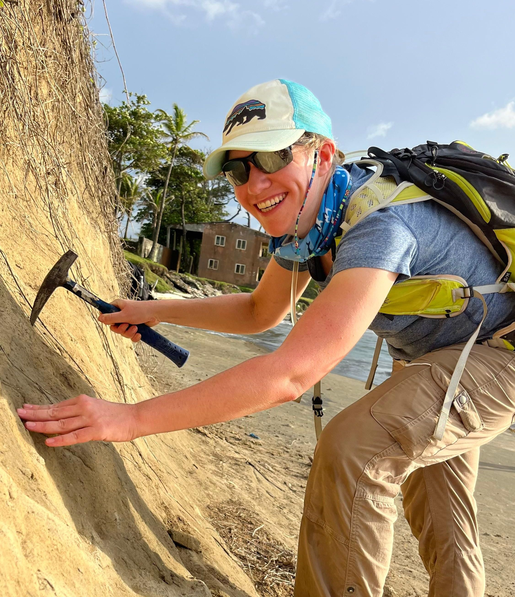

# Erin Dillon

Erin Dillon is an SNSF Postdoctoral Research Fellow in the Department of Palaeontology at the University of Zurich and a Research Associate at the Smithsonian Tropical Research Institute in Panama. Her research integrates ecological, historical, and palaeobiological data to understand how marine predators like elasmobranchs (sharks and rays) respond to human and environmental pressures. As a conservation palaeobiologist, Erin works to place recent ecological change in a long-term context, drawing on Earth's history to inform contemporary and future conservation challenges.

Website: [https://erinmdillon.wordpress.com/](https://erinmdillon.wordpress.com/)

{fig-align="center" width="50%"}
